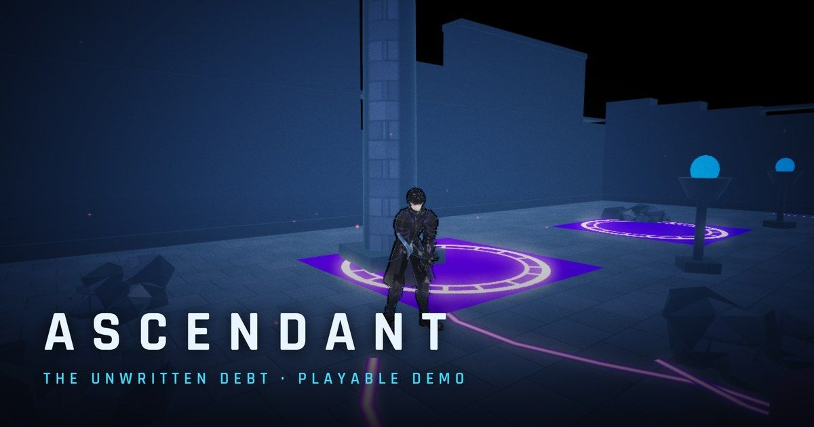
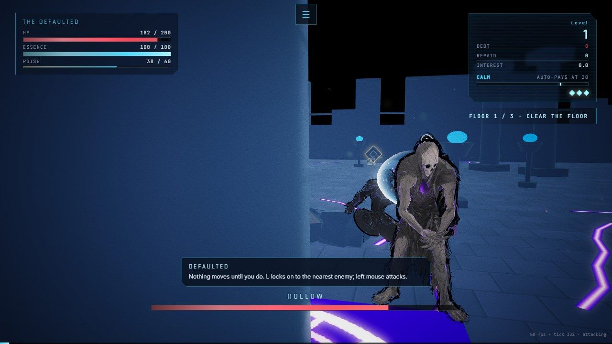
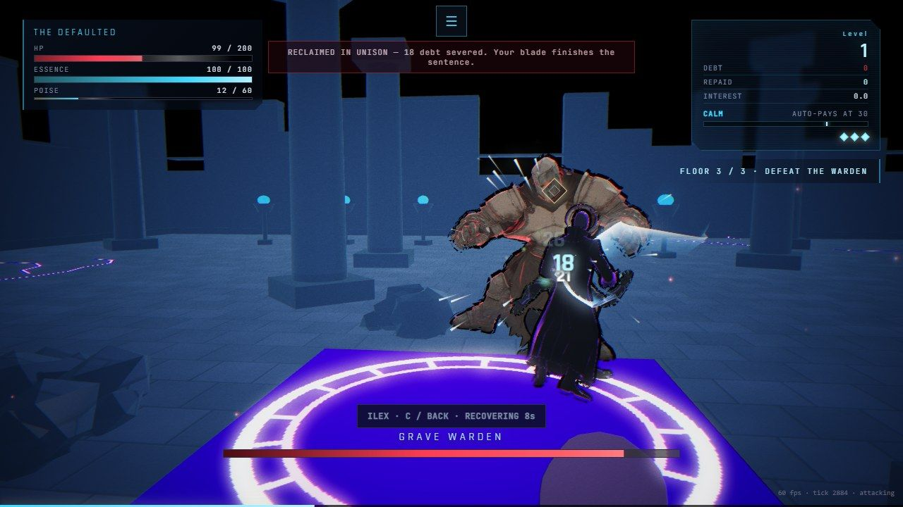
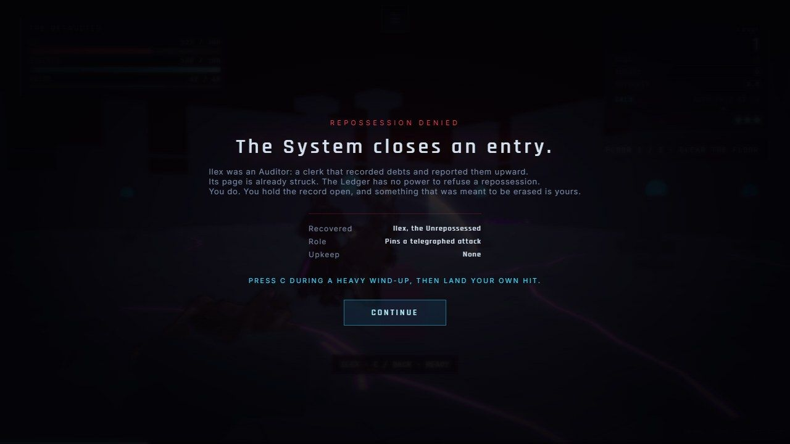
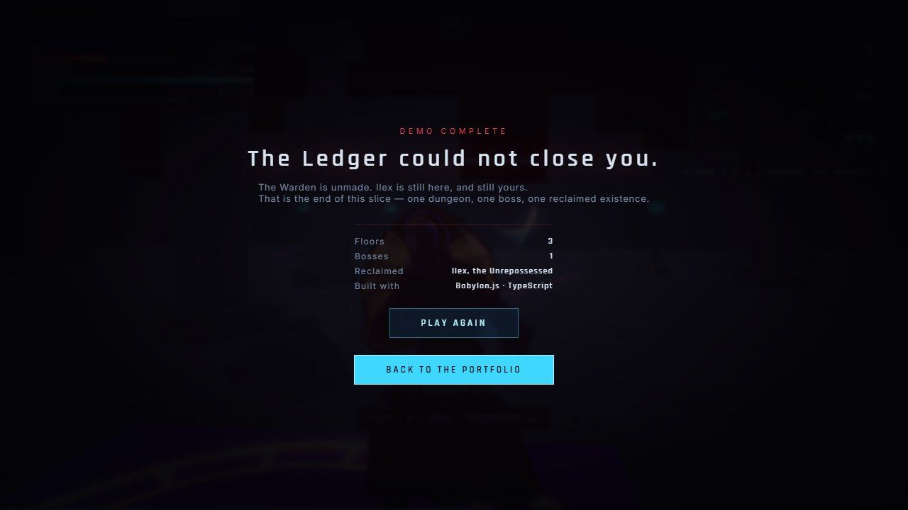

# ASCENDANT — The Unwritten Debt

**A browser-playable action RPG demo.** No install, no account.

### ▶ [Play it now](https://ascendant-rosy.vercel.app) — best on desktop with a mouse; touch and gamepad also work.

## The premise

You died on Earth and woke in Aetheria, where power is *loaned*. Skills are
debts. Levels are credit. Interest accrues on everything you hold, and when you
cannot pay, the Ledger repossesses your **memories**.

You are **Defaulted** — a soul whose account the System cannot close.

## What's in the demo

A short, self-contained slice — three floors, one boss, one reclaimed
companion:

- Descend the three floors of **the Seam**.
- Defeat an **Auditor** — a clerk of the System — and refuse its repossession.
  It becomes **Ilex, the Unrepossessed**: a permanent companion with no upkeep.
- Command Ilex (`C`) during the Warden's heavy wind-up, then land your own hit
  to cash a coordinated strike. Ilex never deals autonomous damage — your blade
  finishes every sentence.
- Defeat the **Grave Warden** on floor 3.

Dying costs a memory. Losing all three restarts the slice from its authored
opening — the demo never strands you.

| Key | Action |
|---|---|
| WASD / Mouse | Move / Camera |
| LMB / `J` | Attack · `U` Heavy (Essence) |
| RMB / `K` | Parry · `Space` Dodge · `Shift` Guard |
| `L` | Lock on |
| `C` | Command Ilex |
| `Esc` | Pause and settings |

## Screenshots

| | |
|---|---|
|  |  |
|  |  |

## How it's built

No game engine, no editor — **Babylon.js + TypeScript** from scratch, in a
monorepo that separates the pure simulation (`engine`), the authored data
(`content`) and the rendering/UI app:

- **~2,700 unit tests** over combat, the debt economy, progression, input and
  UI view-models.
- **Real-input browser verification**: a scripted harness plays the full game
  path — and the demo end to end — in headless Chrome with real mouse and key
  events over CDP, failing on any assertion or console error. Synthetic
  `.click()` is banned; it has hidden real bugs here before.
- **A reachability gate** fails the build when an exported symbol is never
  called from the running game — tests prove code *works*, not that it *runs*.
- **A 19 MB deterministic demo build**: an allowlist trimmer prunes campaign
  assets, and the five shipped character rigs are quantized glTF
  (`KHR_mesh_quantization`) — core glTF the loader already supports, so it
  costs nothing at runtime.
- Sound effects are **procedural Web Audio synthesis**; music tracks are
  generated with ElevenLabs under their licence; character animation is
  Mixamo-sourced, rebaked through a custom FBX→glTF pipeline.
- Built with heavy AI assistance, which is the point: the gates above are what
  keep a largely AI-built codebase honest.

## Status

This demo is the playable slice of a larger single-player campaign in active
development. The game's source is private; this repository is the public
synopsis.

© Andy Salazar. All rights reserved. The demo is free to play at the link
above; the code and assets are not licensed for reuse.
